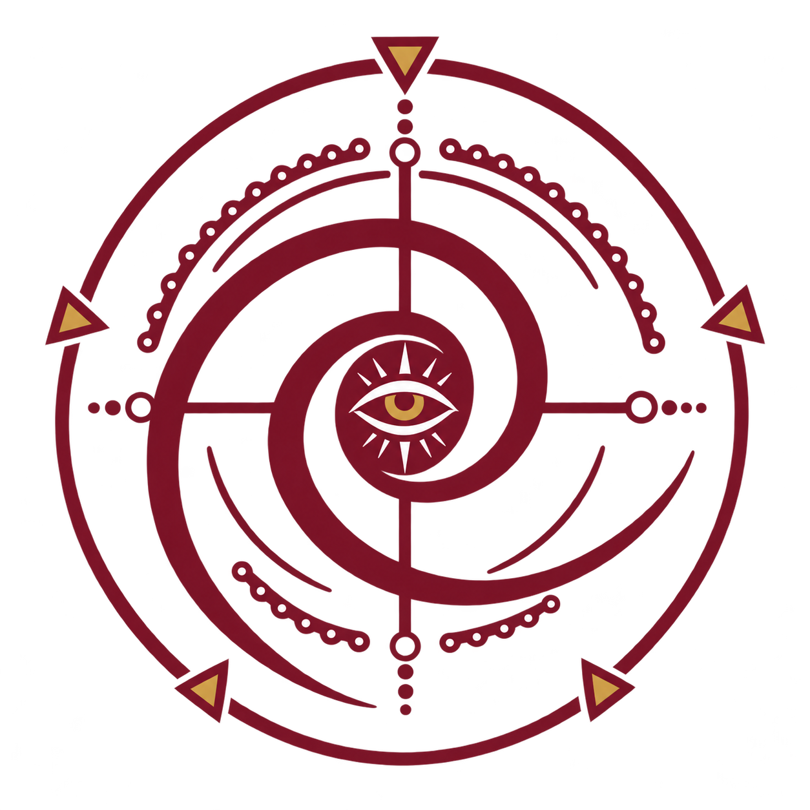

<h1 style="color: #871C32;">THE SPIRAL</h1>

---

<h2 style="color: #D7A74B;">LONG LIVE THE SPIRALL</h2>

Five trials await those who seek the Spiral's infinite wisom.

Everything you need is on the box. Each challenge runs as root and guards the sacred
`/flag`. All challenges are bounded by the divine Fibonnaci spiral.

---

<h2 style="color: #D7A74B;">The Five Trials</h2>

- Spiral Trie - The Labyrinth: Countless paths, countless false prophets. Only those who follow the sacred sequence shall find what they are looking for
- Spiral Web - The Congregation: The disciples each possess but a small fragment of dibine knowledge. Infiltrate the Order, betray their trust, and become one with The Spiral.
- Spiral Cipher - The Scriptue: The sacred text has been scatted among many false prophecies. Only those who follow The Spital may decipher its message
- Spiral Stack - The Sacrifice: The flesh is weak, and memory, weaker. Bend the stack to your will, but remember: The Spiral controls where your offerings fall
- Spiral Brain - The Invocation: Speak in the forbidden tongue. Command the machine through sacred numbers. Invoke the kernel itself, and pray The Spiral answers.

Lost your way? Seek guidance from your fellow disciples in the club Discord.

<h2 style="color: #871C32;">THE SPIRAL SEES ALL. THE SPIRAL FORGIVES NONE.</h2>
